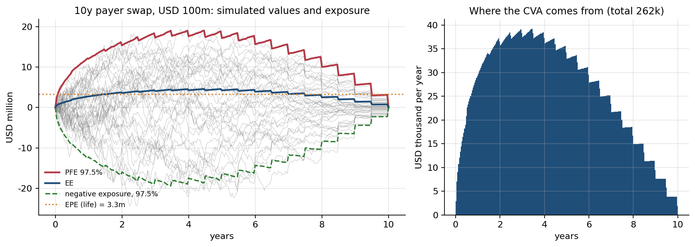
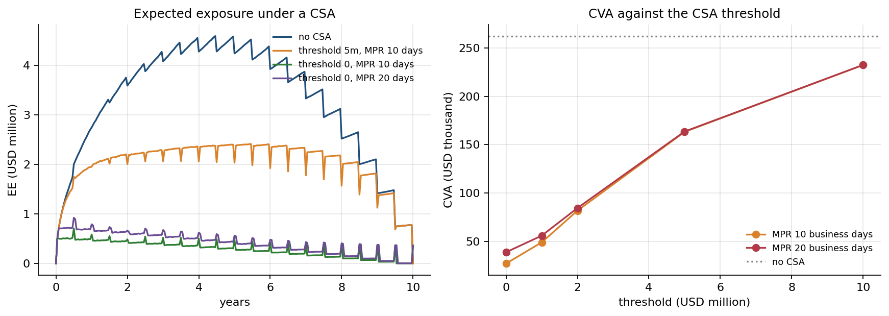
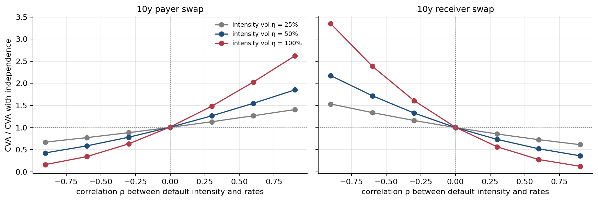

# CVA of an interest rate swap: exposure, collateral, netting and wrong-way risk

A bank pays fixed on a 10-year USD 100 million interest rate swap with a BBB corporate. If
the corporate defaults while the swap is worth money to the bank, the bank loses that value.
This project prices that risk, the **credit valuation adjustment (CVA)**, from free market data:
it bootstraps today's US Treasury curve, simulates a **Hull-White one-factor** model calibrated
to it, builds the **exposure profiles** (EE, PFE 97.5%, EPE), and measures how much a
**collateral agreement**, **netting** and **wrong-way risk** change the answer.

Report (10 pages): [`report/main.pdf`](report/main.pdf) · Walkthrough notebook: [`notebooks/walkthrough.ipynb`](notebooks/walkthrough.ipynb)

## Key results

Valuation date 17 November 2026; 20,000 antithetic paths, two-week grid, exact simulation.

| Question | Result |
|---|---|
| Curve and model | 10y Treasury par yield **5.10%** = par rate of the swap; Hull-White fitted to 3 years of zero-yield volatility: **a = 0.012, σ = 91 bp**, fit error 1.8 bp |
| Exposure of the 10y payer swap | peak EE **USD 4.6m** and peak PFE (97.5%) **USD 19.1m**, both at 4.5 years; EPE over the life USD 3.3m |
| CVA (BBB spread 1.15%, LGD 60%) | **USD 262,000** (s.e. 935) = 26 bp of notional = **3.4 bp a year** on the fixed rate; DVA 137,000 (A spread 0.76%); bilateral CVA − DVA = 122,000 |
| Is the Monte Carlo right? | swap worth 0 at t = 0; E[D(t)] = P(0,t) within 0.03%; discounted EE = **Jamshidian swaption price** at every reset date (max error 1.5%, max \|z\| 2.35 over 19 dates); CVA converges like 1/√N (± 0.8k at 100,000 paths) |
| Collateral (two-way CSA) | threshold 0 and a 10-business-day margin period cut CVA by **90%** (to 27,000); with 20 days, by 85%; a 5m threshold only by 38% |
| Netting | adding an offsetting 5y receiver in the same netting set cuts the combined CVA by **35%**; adding a 5y payer cuts it by 0% |
| Wrong-way risk | if default intensity rises with rates (ρ = +0.6, intensity vol 50%), the payer CVA rises **×1.55** at the same default probabilities; ρ = −0.6 cuts it to ×0.59 |





## Method in one paragraph

Treasury constant-maturity par yields (FRED) are bootstrapped into discount factors (bills as
zero rates, coupon bonds on a 6-month grid, flat forwards between nodes). The short rate is
r(t) = x(t) + φ(t) with dx = −a x dt + σ dW and φ chosen to reproduce today's curve exactly
(G1++ form of Hull-White). Since swaption volatilities are not free, a and σ are fitted to the
historical volatility of zero yields across maturities (σ B(τ)/τ in the model). x(t) and its
integral are simulated exactly as a joint Gaussian, so the deflator has no discretisation bias.
The swap is valued in closed form on every path (single curve, semi-annual legs) every two
weeks; CVA = LGD ∑ EE*(t) ΔPD(t), with a flat hazard rate from the ICE BofA BBB option-adjusted
spread (credit triangle λ = s / LGD). A CSA is modelled by lagging the collateral by the margin
period of risk. Wrong-way risk uses a log-normal intensity λ(t) = φ(t) e^{Y(t)} whose shocks are
correlated with the rate shocks, recalibrated for each correlation so that the default
probabilities stay on the market curve.

## Project structure

```
src/
  curve.py        discount curve, Treasury bootstrap
  hull_white.py   Hull-White 1F: bond prices, exact simulation, Jamshidian swaption, calibration
  swap.py         swap value today and on simulated paths
  exposure.py     netting-set simulation, EE / PFE / EPE, collateral with threshold and MPR
  cva.py          hazard rates, CVA / DVA / bilateral CVA, wrong-way-risk intensity model
  market.py       trade and Monte Carlo settings, calibrated market
scripts/
  01_download_data.py         FRED: Treasury par yields, SOFR, BBB and A credit spreads
  02_curve_and_calibration.py curve, historical yield vols, Hull-White fit       -> figures 1-2
  03_exposure_cva.py          exposure, CVA/DVA, swaption check, convergence     -> figures 3-5
  04_collateral_netting.py    CSA threshold and MPR, netting sets                 -> figures 6-7
  05_wrong_way_risk.py        correlated default intensity                        -> figure 8
notebooks/walkthrough.ipynb  the story in short cells
tests/test_core.py           23 tests (bootstrap, martingale, swaption parity, Jamshidian vs MC, CVA, CSA, WWR)
results/                     every number of the report, as JSON
report/                      LaTeX source (article class), references, compiled PDF
```

## Reproduce

```bash
python -m venv .venv && .venv/Scripts/activate      # or source .venv/bin/activate
pip install -r requirements.txt
python run_all.py              # recompute everything from the saved snapshot + run the tests (about 2 minutes)
python run_all.py --download   # download fresh FRED data first (numbers will change)
```

The report compiles with `latexmk -pdf main.tex` in `report/`, or by uploading
`report/overleaf_upload.zip` to Overleaf (New project → Upload project).

## Data and limitations

- **Free data only** (FRED, no account): Treasury par yields 1 month–30 years (H.15), SOFR,
  ICE BofA US corporate BBB and A option-adjusted spreads (the ICE series on FRED only go back
  three years).
- **Treasury curve, not a SOFR swap curve.** Free sources have no SOFR swap rates, so the swap is
  priced on the Treasury curve with a single curve for projection and discounting. A real USD
  swap would use the SOFR OIS curve; the Treasury–SOFR swap spread is ignored.
- **Historical, not implied, volatility.** A desk calibrates Hull-White to swaption implied vols
  (not free). Here a and σ match three years of realised zero-yield volatility; the 1-year point
  (65 bp, anchored by Fed policy) is left out of the fit because one factor cannot produce the
  hump of the volatility curve.
- **One factor**: all rates move together, so two swaps in the same direction give almost no
  netting benefit; a two-factor model would give some.
- **Credit**: flat hazard rate from a bond index spread (not the counterparty's own CDS),
  LGD 60% assumed; wrong-way-risk parameters (intensity vol 50%, mean reversion 0.1) are
  assumptions, so the WWR results are a sensitivity analysis, not a calibrated number.
- Simplified CSA (no minimum transfer amount, no independent amount, collateral in cash, no
  initial margin), simple 0.5 accruals, no business-day calendar, no funding (FVA) or capital (KVA).

## References

Hull & White (1990); Jamshidian (1989); Brigo & Mercurio (2006); Gregory (2020); Brigo,
Morini & Pallavicini (2013); Pykhtin & Zhu (2007); Basel Committee (2017, SA-CCR/CVA);
Hull & White (2012, wrong-way risk). Full list in [`report/references.bib`](report/references.bib).

Author: Andreas Kyrlakis, MSc in Finance, HEC Lausanne.
